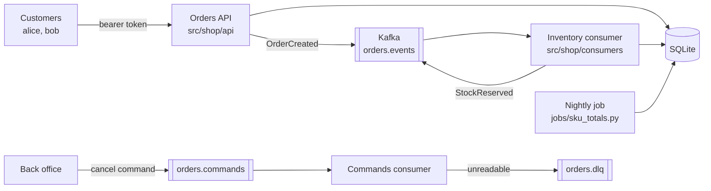

# K11 Shop: a live demo of the k11 Release Gate Action

[](https://github.com/K11-Software-Solutions/k11techlab-release-gate-demo/actions/workflows/release-gate.yml)

**Can this pull request ship?** This repository is a small but real event-driven system with a full QA pipeline. Every
pull request gets one decision from the [k11 Release Gate Action](https://github.com/marketplace/actions/k11-release-gate):
**ship**, **ship with conditions**, **needs a named person**, or **block**, with every reason and the evidence behind it.

The open pull requests below are kept as live examples. Open one to see the gate's comment.

## See it decide

| Pull request | The change | Caught by | Verdict |
|---|---|---|---|
| _showcase PRs are linked here once they are open_ | | | |

## The system



- **Orders API** (`src/shop/api/`): place, list, get and cancel orders. Bearer-token auth (`src/shop/auth/`); customers only ever see their own orders.
- **Kafka events**: `OrderCreated`, `StockReserved`, `OrderCancelled`, described in [`asyncapi.yaml`](asyncapi.yaml).
- **Inventory consumer**: reserves stock for new orders and releases it for cancelled ones.
- **Commands consumer**: back-office cancel commands; anything it can't read goes to the **dead-letter queue** with the reason.
- **Batch job**: `jobs/sku_totals.py`, safe to rerun.
- **Contract**: [`openapi.yaml`](openapi.yaml), with two known consumers in [`.qa-mcp/consumers.yaml`](.qa-mcp/consumers.yaml): the **mobile app** (critical) and **analytics** (medium).

## The pipeline

[`.github/workflows/release-gate.yml`](.github/workflows/release-gate.yml) runs on every pull request:

| Job | Tool | Evidence |
|---|---|---|
| Unit tests | pytest | `test-results/junit.xml` |
| API functional + security | [k11 API Functional QA](https://github.com/K11-Software-Solutions/k11techlab-api-functional-qa-mcp), [k11 API Security QA](https://github.com/K11-Software-Solutions/k11techlab-api-security-qa-mcp) | flows with database checks; OWASP API Top 10 as two test users |
| API contract | [k11 API Contract QA](https://github.com/K11-Software-Solutions/k11techlab-api-contract-qa-mcp) | breaking changes against the base branch and the consumers they affect |
| Integration | [k11 Integration QA](https://github.com/K11-Software-Solutions/k11techlab-integration-qa-mcp) on a real Apache Kafka | events, consumers, dead-letter queue, batch job, AsyncAPI schemas |
| **Release gate** | [k11 Release Gate Action](https://github.com/K11-Software-Solutions/k11techlab-release-gate-action) | one decision under [`.qa-mcp/release-policy.yaml`](.qa-mcp/release-policy.yaml), as a PR comment |

The test jobs report with `--fail-on never`, and the gate applies one policy to all of their evidence. The policy requires unit
and API tests on every change; the rest is **change-aware**. A change to `openapi.yaml` requires the contract check,
to `src/shop/auth/` security, and to `src/shop/consumers/`, `jobs/` or `asyncapi.yaml` integration.

## Run it yourself

```bash
pip install -e ".[dev]"
pytest                                     # unit tests
python -m shop.app --port 8095             # the shop, with an in-process bus (add --kafka localhost:9092 for Kafka)
```

Then, with the K11 tools installed (`pip install k11-api-functional-qa-mcp k11-api-security-qa-mcp k11-release-gate-mcp`):

```bash
export SHOP_URL=http://127.0.0.1:8095 ALICE_TOKEN=alice-test-token BOB_TOKEN=bob-test-token
k11-api-functional-qa-mcp run --env ci
k11-api-security-qa-mcp run --env ci --no-scanners
k11-release-gate-mcp evaluate --base origin/main
```

The tokens are for the demo's TEST users only. A real project keeps them in secrets.

## Use it in your project

```yaml
- uses: K11-Software-Solutions/k11techlab-release-gate-action@v1
```

See the action's [usage guide](https://github.com/K11-Software-Solutions/k11techlab-release-gate-action/blob/main/docs/usage.md).
For the same decision from Claude Code before you push, there's the [Release Readiness Agent](https://github.com/K11-Software-Solutions/k11techlab-release-readiness-agent).

---

Built by [K11 Software Solutions](https://k11softwaresolutions.com). MIT licensed.
